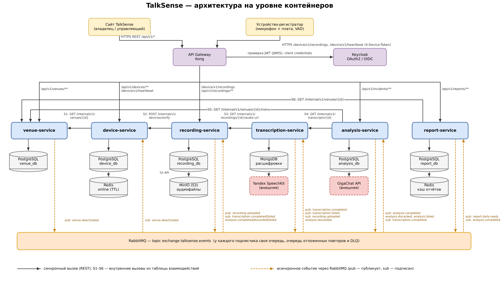
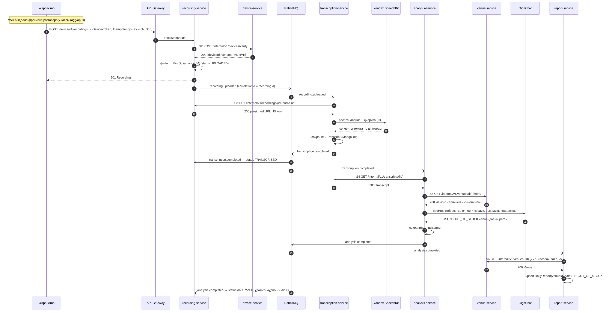
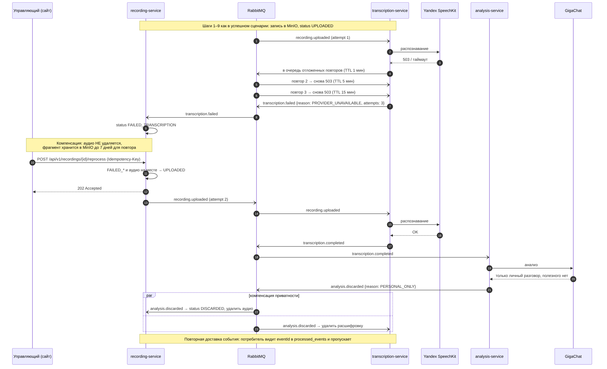

# TalkSense — речевая аналитика для точек продаж

[](https://github.com/OWNER/REPO/actions/workflows/ci.yml)

**Лабораторные работы №3–5: проектирование, реализация и CI/CD микросервисной системы**
Дисциплина «Распределённые и облачные системы» · Выполнила: Акобян Г.П., гр. ВМО42 · Принял: Булыгин Р.Д.

> Предметная область совпадает с темой ВКР: аппаратно-программный комплекс, который записывает разговоры
> клиентов с персоналом в кофейнях и булочных и автоматически формирует для владельца выгрузку инцидентов за день.

| Лабораторная | Что сделано | Где |
|--------------|-------------|-----|
| ЛР3. Проектирование | контексты, 6 сервисов, выбор ПО, схемы, OpenAPI + AsyncAPI | разделы 1–7 ниже, `docs/`, `api/` |
| ЛР4. Реализация | 6 сервисов на FastAPI, RabbitMQ, сага с компенсациями, шлюз, моки, 89 тестов | [раздел «ЛР4»](#лр4-реализация-микросервисов), `services/`, `docs/demo-scenarios.md` |
| ЛР5. CI/CD | GitHub Actions: lint → build → test → Docker → GHCR → staging + smoke-тест | [раздел «ЛР5»](#лр5-cicd), `.github/workflows/`, `docs/cicd.md` |

## Содержание

0. [ЛР4. Реализация микросервисов](#лр4-реализация-микросервисов) · [ЛР5. CI/CD](#лр5-cicd)
1. [Предметная область, акторы, сценарии](#1-предметная-область)
2. [Доменные события и ограниченные контексты](#2-доменные-события-и-ограниченные-контексты)
3. [Карточки сервисов и отвергнутые варианты](#3-сервисы)
4. [Выбранное ПО](#4-выбранное-по)
5. [Схемы и таблица взаимодействий](#5-схемы-и-взаимодействия)
6. [Перечень событий](#6-перечень-событий)
7. [Контракты API](#7-контракты-api)

---

## ЛР4. Реализация микросервисов

### Быстрый запуск

```bash
docker compose up -d --build          # 6 сервисов + RabbitMQ + шлюз + 2 мока
docker compose ps                     # все сервисы healthy
pip install httpx && python demo/run_demo.py   # сценарии 1–4 через шлюз http://localhost:8080
```

- Swagger UI сервиса — `/docs` при локальном запуске (см. ниже); в compose порты сервисов наружу не публикуются, вход только через шлюз
- Консоль RabbitMQ: http://localhost:15672 (talksense / talksense) — видны очереди `*.events`, `*.retry`, `*.dlq`
- Postman: импортировать `postman/TalkSense.postman_collection.json`, перед этим `python demo/make_audio.py`

Без Docker (для разработки) нужен локальный RabbitMQ; сервис запускается так:
`cd services/venue-service && PYTHONPATH=../common SEED_DEMO=1 RABBITMQ_URL=amqp://… uvicorn venue_service.main:app --port 8101`.
Без `RABBITMQ_URL` сервис работает со шиной в памяти (удобно для отладки одного сервиса).

### Стек и обоснование

**Python 3.12 + FastAPI** для всех сервисов. Интеграции с SpeechKit и GigaChat в проекте ВКР уже написаны на
Python, так что код и опыт переиспользуются. FastAPI строит OpenAPI по Pydantic-моделям, и реализацию легко сверить
с контрактами ЛР3. Асинхронность (`async/await`) удобна для сервисов, которые в основном ждут внешние API и брокер.
Брокер — **RabbitMQ** (`aio-pika`), как и в проекте. Шлюз — **Nginx** (в проекте Kong; методичка разрешает
минимальный шлюз).

### Что реализовано

| Требование методички | Реализация |
|----------------------|-----------|
| ≥ 4 бизнес-сервисов | **6**: venue, device, recording, transcription, analysis, report |
| Своё хранилище у каждого | отдельная БД SQLite в отдельном томе (`/data/<service>.db`); аудио — в томе recording-service |
| ≥ 3 синхронных взаимодействий | **6** (S1–S6) по контрактам ЛР3, сервисный токен, таймауты, повторы GET, circuit breaker (`talksense_common/http.py`) |
| ≥ 2 асинхронных взаимодействий | **8 типов событий** через RabbitMQ; Transactional Outbox у издателей; дедупликация по `eventId`; отложенные повторы и DLQ (`talksense_common/events.py`) |
| Сквозной сценарий ≥ 3 сервисов с обработкой сбоев | сага «Обработка записи»: recording → transcription → analysis → report (+ device, venue); компенсации: сохранение аудио при сбое, удаление аудио и расшифровки при `analysis.discarded`, `reprocess` (`recording_service/saga.py`) |
| Клиент только через Gateway | `gateway/nginx.conf`; наружу опубликован только порт 8080 (и порты моков/консоли RabbitMQ для демо) |
| Idempotency-Key | загрузка фрагмента, создание заведения, регистрация устройства, перезапуск обработки |
| Единая модель ошибок | Problem Details (RFC 9457/7807) во всех сервисах, включая ошибки валидации и шлюза |
| Unit- и интеграционные тесты | **89 тестов** (`pytest`): unit — бизнес-логика анализа, машина состояний саги, агрегация отчёта, адаптер SpeechKit, общая библиотека; API-тесты сервисов с моками зависимостей; 13 сквозных тестов саги через все 6 сервисов |

**Что работает через моки, а что по-настоящему,** расписано в [docs/demo-scenarios.md](docs/demo-scenarios.md#что-реально-а-что-мок).
Кратко: шлюз, HTTP между сервисами и RabbitMQ настоящие; SpeechKit и GigaChat — моки с теми же контрактами
(адаптеры в сервисах настоящие, переключаются переменными окружения); MinIO, PostgreSQL, MongoDB и Redis заменены
файловым хранилищем и SQLite; Keycloak не поднимается.

### Ключевая бизнес-логика

- **analysis-service** (`analysis_service/logic.py`): промпт для GigaChat, валидация ответа модели по схеме, сопоставление
  реплики гостя с меню (название, синонимы, основы слов в любом порядке, нечёткое сходство), правило «позиция есть
  в меню → `OUT_OF_STOCK`, нет → `MENU_REQUEST`» поверх ответа модели, отсев записей без полезного содержания.
- **recording-service** (`recording_service/saga.py`): машина состояний саги, допускающая события не по порядку,
  правила удаления аудио и перезапуска.
- **report-service** (`report_service/aggregate.py`): инкрементальная агрегация отчёта, каждая запись учитывается ровно один раз.

### Тесты

```bash
pip install -r services/requirements-dev.txt
pytest                                  # все 89 тестов
cd services/analysis-service && pytest  # тесты одного сервиса
ruff check .                            # линтер
```

Сценарии, проверенные вживую (успешный путь, сбой SpeechKit с компенсацией и перезапуском, идемпотентность,
ошибки), с выводом и логами: [docs/demo-scenarios.md](docs/demo-scenarios.md).

---

## ЛР5. CI/CD

**Пайплайн:** https://github.com/OWNER/REPO/actions/workflows/ci.yml *(заменить OWNER/REPO после публикации репозитория,
так же в бейдже вверху)*. Подробно: [docs/cicd.md](docs/cicd.md).

Платформа: **GitHub Actions**. Код уже на GitHub, реестр GHCR встроен, секрет реестра выдаётся автоматически
(`GITHUB_TOKEN`), а матрица и переиспользуемый workflow описывают пайплайн сервиса один раз для всех образов.

| Этап | Что делает |
|------|-----------|
| api-contracts | `redocly lint` OpenAPI, `asyncapi validate` |
| build | кэш pip, `ruff check`, `compileall` — для каждого из 6 сервисов (матрица, `service.yml`) |
| test | unit/API-тесты сервиса + интеграционные тесты саги (89 тестов), JUnit-артефакты |
| package | `docker build` 8 образов (6 сервисов + 2 мока), кэш слоёв, скан Trivy |
| publish *(CD, main)* | push в `ghcr.io/<owner>/talksense-<name>:<sha7>` и `:latest` |
| deploy *(CD, main)* | `docker compose up --wait` из опубликованных образов на раннере (`docker-compose.staging.yml`), smoke-тест `demo/run_demo.py` через шлюз |

Триггеры: `push` и `pull_request` в `main`, ручной запуск. Падение тестов любого сервиса блокирует сборку его образа
и деплой ([пример](docs/cicd.md#3-неуспешный-прогон)).

Проверить локально: `pip install -r services/requirements-dev.txt && bash scripts/ci-local.sh`.

---

## 1. Предметная область

### Описание системы

TalkSense помогает владельцу небольшого заведения (кофейня, булочная, магазин у дома) понять, что происходит у кассы,
не прослушивая записи и не просматривая камеры. Устройство-регистратор с направленным микрофоном стоит у кассы, выделяет
фрагменты разговора (VAD) и отправляет их на сервер. Сервер переводит речь в текст через Yandex SpeechKit, а модель
GigaChat отбрасывает личные разговоры и «воду» и выделяет только то, что полезно бизнесу: конфликты, позиции, которых
не оказалось в наличии, просьбы добавить что-то в меню, жалобы и благодарности. На сайте владелец видит выгрузку
инцидентов за день и динамику по точкам.

### Акторы

| Актор | Тип | Что делает в системе |
|-------|-----|----------------------|
| Владелец бизнеса | пользователь | смотрит отчёты по всем точкам, управляет заведениями и меню |
| Управляющий точки | пользователь | смотрит инциденты своей точки, отмечает их как подтверждённые или ложные, отмечает наличие позиций |
| Администратор TalkSense | пользователь | регистрирует и отзывает устройства, перезапускает упавшую обработку записей |
| Устройство-регистратор | внешняя система (IoT) | отправляет аудиофрагменты и heartbeat |
| Yandex SpeechKit | внешняя система | распознавание речи с диаризацией (разделением дикторов) |
| GigaChat API | внешняя система | анализ расшифровки большой языковой моделью |
| Keycloak | внешняя система | аутентификация пользователей и сервисов (OAuth 2.0 / OIDC) |

### Пользовательские сценарии

1. Как **владелец**, я хочу утром открыть выгрузку за вчерашний день, чтобы за пару минут узнать о конфликтах и проблемах, не слушая записи.
2. Как **владелец**, я хочу видеть, какие позиции гости спрашивали, а их не было в наличии, чтобы скорректировать закупки.
3. Как **владелец**, я хочу видеть, что гости просят добавить в меню, чтобы принимать решения о новых позициях на основе спроса.
4. Как **управляющий**, я хочу отметить инцидент как ложный, чтобы отчёт был точнее, а качество анализа можно было измерить.
5. Как **управляющий**, я хочу отмечать в меню, что позиция закончилась, чтобы ИИ правильно отличал «нет в наличии» от «нет в меню».
6. Как **администратор**, я хочу привязать новое устройство к точке за один шаг, чтобы быстро подключать клиентов.
7. Как **администратор**, я хочу видеть устройства не в сети и записи с ошибкой обработки, чтобы перезапустить обработку без потери данных.
8. Как **гость заведения**, я хочу, чтобы мои личные разговоры не хранились, поэтому записи без полезного для бизнеса содержания удаляются сразу после анализа.

---

## 2. Доменные события и ограниченные контексты

### Доменные события (упрощённый Event Storming)

`ЗаведениеСоздано` · `ПозицияМенюДобавлена` · `ПозицияЗакончилась` · `ЗаведениеОтключено` ·
`УстройствоЗарегистрировано` · `УстройствоВышлоНаСвязь` · `УстройствоПотерялоСвязь` · `УстройствоОтозвано` ·
`ФрагментЗаписан` · `ЗаписьЗагружена` · `РасшифровкаГотова` · `РаспознаваниеНеУдалось` ·
`ЗаписьОтброшена` (личный разговор / шум) · `ИнцидентВыявлен` · `АнализНеУдался` · `ИнцидентПодтверждён` ·
`ИнцидентПризнанЛожным` · `ОтчётЗаДеньОбновлён` · `ДеньЗакрыт` · `АудиоУдалено`

### Ограниченные контексты и глоссарии

**Заведения (Venue)**: события про заведения и меню.
- *Заведение*: точка продаж с адресом, часовым поясом и графиком работы.
- *Позиция меню*: товар с синонимами (как его называют гости) и признаком наличия.
- *Наличие*: позиция есть в меню, но может временно закончиться.

**Устройства (Device)**: регистрация, связь, отзыв.
- *Устройство*: регистратор с серийным номером, привязанный к одному заведению.
- *Токен устройства*: секрет, которым устройство подписывает запросы.
- *В сети*: heartbeat приходил не позже 2 минут назад.

**Запись (Recording)**: приём аудио и путь записи через конвейер.
- *Фрагмент*: отрезок речи, выделенный VAD на устройстве (до 10 минут).
- *Запись*: принятый сервером фрагмент с метаданными и статусом обработки.
- *Статус обработки*: состояние саги (`UPLOADED → TRANSCRIBED → ANALYZED / DISCARDED / FAILED_*`).
- *Очистка аудио*: удаление исходного файла после анализа (минимизация персональных данных).

**Распознавание (Transcription)**
- *Расшифровка*: текст записи, разбитый на сегменты.
- *Сегмент*: реплика одного диктора с таймкодами и уверенностью распознавания.
- *Диктор*: метка говорящего (S1, S2) без привязки к личности.

**Анализ (Analysis)**
- *Инцидент*: значимое для бизнеса событие в разговоре (CONFLICT, OUT_OF_STOCK, MENU_REQUEST, COMPLAINT, PRAISE, SERVICE_ISSUE).
- *Полезная доля*: часть текста, относящаяся к обслуживанию, а не к личным разговорам.
- *Разметка*: оценка инцидента менеджером (подтверждён / ложный).

**Отчётность (Reporting)**
- *Отчёт за день*: агрегат инцидентов точки за календарный день в её часовом поясе.
- *Закрытие дня*: момент, после которого отчёт больше не меняется (через 2 часа после закрытия точки).
- *Главное за день*: короткий список самых важных инцидентов.

Слово «запись» в разных контекстах значит разное: для recording-service это файл и статус обработки, для
analysis-service это источник инцидентов, а report-service знает только счётчик проанализированных записей. Поэтому
общей сущности «Запись» на всю систему нет.

---

## 3. Сервисы

В системе 6 бизнес-сервисов. API Gateway (Kong) и Keycloak — инфраструктура, в это число они не входят.

### venue-service

| Поле | Значение |
|------|----------|
| Ответственность | Справочник заведений и их меню: что продаётся, как гости это называют, есть ли позиция в наличии |
| Владеет данными | Organization, Venue, MenuItem |
| Предоставляет | `GET/POST /api/v1/venues`, `GET /api/v1/venues/{id}`, `POST /api/v1/venues/{id}/deactivate`, `GET/POST /api/v1/venues/{id}/menu`, `PUT .../menu/{itemId}`; internal: `GET /internal/v1/venues/{id}`, `GET /internal/v1/venues/{id}/menu`; событие `venue.deactivated` |
| Зависит от | — (листовой сервис) |
| НФТ | Низкая нагрузка на запись; чтение меню — на каждую расшифровку (сотни в день на точку); p95 < 100 мс; кэширование ответов у потребителей |
| Обоснование границы | Данные справочника меняются вручную и редко, их читают три других сервиса. Отдельный владелец исключает расхождение меню между сервисами |

### device-service

| Поле | Значение |
|------|----------|
| Ответственность | Регистрация и активация устройств, выдача и проверка их токенов, мониторинг связи |
| Владеет данными | Device, DeviceToken (хэш), статус «в сети» |
| Предоставляет | `GET/POST /api/v1/devices`, `GET /api/v1/devices/{id}`, `POST /api/v1/devices/{id}/revoke`, `POST /device/v1/heartbeat`; internal: `POST /internal/v1/devices/verify` |
| Зависит от | venue-service (S1, при регистрации); подписан на `venue.deactivated` |
| НФТ | Heartbeat раз в минуту от каждого устройства: при 1000 устройств ~17 RPS мелких запросов. Verify вызывается на каждую загрузку, p95 < 30 мс |
| Обоснование границы | Совсем другой профиль нагрузки, чем у приёма аудио (частые мелкие запросы против редких больших файлов). Безопасность устройств (токены, отзыв) — отдельная зона ответственности |

### recording-service

| Поле | Значение |
|------|----------|
| Ответственность | Приём аудиофрагментов, их хранение и **владение состоянием саги** обработки каждой записи; очистка аудио по политике хранения |
| Владеет данными | Recording (метаданные и статус), аудиофайлы в MinIO, ProcessedEvent |
| Предоставляет | `POST /device/v1/recordings`, `GET /api/v1/recordings`, `GET /api/v1/recordings/{id}`, `POST /api/v1/recordings/{id}/reprocess`; internal: `GET /internal/v1/recordings/{id}/audio-url`; событие `recording.uploaded` |
| Зависит от | device-service (S2); подписан на `transcription.completed/failed`, `analysis.completed/discarded/failed` |
| НФТ | Критичный путь: потеря фрагмента — потеря данных. Файлы до 20 МБ; при 1000 точек ~50 загрузок в минуту в пиковые часы. Идемпотентный приём (устройство повторяет отправку) |
| Обоснование границы | Работа с объектным хранилищем и большими телами запросов; единая точка, которая знает, на каком шаге каждая запись, — проще мониторинг и перезапуск |

### transcription-service

| Поле | Значение |
|------|----------|
| Ответственность | Перевод аудио в текст через Yandex SpeechKit с диаризацией, хранение расшифровок |
| Владеет данными | Transcript, Segment |
| Предоставляет | `GET /api/v1/transcripts/by-recording/{id}` (только ADMIN); internal: `GET /internal/v1/transcripts/{id}`; события `transcription.completed`, `transcription.failed` |
| Зависит от | recording-service (S3), Yandex SpeechKit; подписан на `recording.uploaded`, `analysis.discarded` |
| НФТ | Длительная асинхронная операция (десятки секунд); платный внешний API с квотами — нужны ограничение параллельности и повторы с задержкой |
| Обоснование границы | Изолирует интеграцию с одним внешним провайдером: его можно заменить (например, на Whisper) без изменений в других сервисах. Масштабируется по длине очереди независимо от анализа |

### analysis-service

| Поле | Значение |
|------|----------|
| Ответственность | ИИ-анализ расшифровки: отсев личных разговоров, выделение инцидентов, сопоставление с меню; хранение и разметка инцидентов |
| Владеет данными | Incident, AnalysisRun (промпт, версия модели, токены) |
| Предоставляет | `GET /api/v1/incidents`, `GET/PATCH /api/v1/incidents/{id}`; события `analysis.completed`, `analysis.discarded`, `analysis.failed` |
| Зависит от | transcription-service (S4), venue-service (S5), GigaChat; подписан на `transcription.completed` |
| НФТ | Вызов LLM 2–15 с, ограничения по токенам и тарифу; результат должен быть строго валидным JSON (проверка схемы ответа) |
| Обоснование границы | Логика промптов и классификации меняется чаще всего (основная ценность продукта), и её нужно выкатывать отдельно. Ошибка GigaChat не должна вызывать повторного платного распознавания |

### report-service

| Поле | Значение |
|------|----------|
| Ответственность | Ежедневные выгрузки для сайта: агрегаты по типам инцидентов, топ «нет в наличии», топ «просили добавить», экспорт CSV |
| Владеет данными | DailyReport, ItemCount |
| Предоставляет | `GET /api/v1/reports/daily`, `GET /api/v1/reports/daily/{venueId}/{date}`, `GET .../export`; событие `report.daily-ready` |
| Зависит от | venue-service (S6); подписан на `analysis.completed` |
| НФТ | Нагрузка на чтение (сайт, утренний пик), p95 < 200 мс; закрытые дни неизменны — кэшируются в Redis |
| Обоснование границы | CQRS: модель чтения отделена от модели записи (инцидентов). Сайт не нагружает analysis-service, а сбой отчётов не останавливает конвейер |

### Отвергнутые варианты разбиения

- **Объединить transcription и analysis в один ai-pipeline-service.** Отказались. Это два разных внешних провайдера с разными квотами и временем ответа, а при сбое GigaChat пришлось бы заново платить за распознавание. Логика анализа меняется гораздо чаще, чем распознавание.
- **Объединить device и recording.** Отказались. Разный профиль нагрузки (heartbeat против файлов), разные хранилища. Отзыв скомпрометированного устройства — задача безопасности, а не приёма аудио.
- **Выделить menu-service из venue-service.** Отказались. Меню всегда принадлежит заведению и меняется вместе с ним, данных мало. Это было бы дробление «сервис на таблицу».
- **Строить отчёты внутри analysis-service.** Отказались. Чтение сайтом и тяжёлые фоновые вызовы LLM нужно масштабировать по-разному, а отдельная модель чтения позволяет кэшировать закрытые дни.
- **Оркестратор саги (отдельный сервис или Temporal).** Отказались в пользу хореографии: цепочка линейная (4 шага), а роль «владельца состояния» уже естественно выполняет recording-service.

---

## 4. Выбранное ПО

| Компонент | Кто использует | Обоснование |
|-----------|----------------|-------------|
| **PostgreSQL 16** (отдельная БД на сервис) | venue, device, recording, analysis, report | Транзакции и строгая схема. venue: связи «организация → заведение → меню». recording: атомарные переходы статусов саги (`UPDATE ... WHERE status = ...`) и уникальный индекс `(device_id, chunk_id)` для идемпотентности. analysis: фильтры инцидентов по точке, дате и типу. report: upsert агрегатов `ON CONFLICT` |
| **MongoDB 7** | transcription | Расшифровка читается и пишется целиком, как документ с массивом сегментов. Структура ответа зависит от провайдера и версии (при смене SpeechKit на Whisper не нужна миграция схемы). TTL-индекс автоматически удаляет расшифровки старше 30 дней |
| **MinIO** (S3-совместимое) | recording | Аудиофайлы до 20 МБ не хранятся в БД. Presigned URL позволяет transcription-service скачать файл напрямую, не гоняя его через API. Lifecycle-правило удаляет файлы старше 7 дней |
| **Redis 7** | device, report | device: статус «в сети» — ключ `device:{id}:online` с TTL 120 с, обновляется каждым heartbeat, без записи в PostgreSQL раз в минуту на каждое устройство. report: кэш закрытых дней (неизменяемые данные, утренний пик чтения) |
| **RabbitMQ 3.13** | все 6 сервисов | Нужны повторы с задержкой (SpeechKit/GigaChat недоступен → 1, 5, 15 мин) через TTL-очереди и DLQ, а также маршрутизация по routing key (topic exchange). Поток небольшой (сотни сообщений в минуту), повторное чтение истории не требуется. Kafka рассматривали и отклонили: её сильные стороны (огромный поток, replay) здесь не нужны, а отложенные повторы на ней делать сложнее |
| **Kong** (API Gateway) | вход для сайта и устройств | Декларативная конфигурация (DB-less), плагины из коробки: проверка JWT Keycloak, rate limiting (защита от «зациклившегося» устройства), ограничение размера тела, проброс `X-Correlation-Id`. Internal-эндпоинты наружу не маршрутизируются |
| **Keycloak** | Gateway, все сервисы (client credentials) | OAuth 2.0 / OIDC без собственной реализации: роли OWNER / MANAGER / ADMIN для сайта, сервисные учётки для internal-вызовов |
| **Yandex SpeechKit** | transcription | Хорошее качество распознавания русской речи, асинхронное распознавание длинных файлов и диаризация; хранение данных в РФ |
| **GigaChat API** | analysis | Русскоязычная LLM с размещением в РФ (важно для персональных данных по 152-ФЗ), поддерживает ответ в формате JSON |

---

## 5. Схемы и взаимодействия

### Архитектурная схема



Исходник для draw.io: [`docs/architecture.drawio`](docs/architecture.drawio). Векторная версия: [`docs/architecture.svg`](docs/architecture.svg).

### Таблица взаимодействий

| № | Инициатор → получатель | Тип | Эндпоинт или событие | Назначение |
|---|------------------------|-----|----------------------|------------|
| 1 | сайт → venue (через Gateway) | sync | `GET /api/v1/venues`, `/menu` | заведения и меню |
| 2 | сайт → report | sync | `GET /api/v1/reports/daily/{venueId}/{date}` | выгрузка за день |
| 3 | сайт → analysis | sync | `GET /api/v1/incidents`, `PATCH /api/v1/incidents/{id}` | инциденты и их разметка |
| 4 | устройство → recording | sync | `POST /device/v1/recordings` | загрузка фрагмента |
| 5 | устройство → device | sync | `POST /device/v1/heartbeat` | признак «в сети» |
| S1 | device → venue | sync | `GET /internal/v1/venues/{id}` | проверить заведение при регистрации устройства |
| S2 | recording → device | sync | `POST /internal/v1/devices/verify` | проверить токен, получить venueId |
| S3 | transcription → recording | sync | `GET /internal/v1/recordings/{id}/audio-url` | временная ссылка на аудио |
| S4 | analysis → transcription | sync | `GET /internal/v1/transcripts/{id}` | получить текст |
| S5 | analysis → venue | sync | `GET /internal/v1/venues/{id}/menu` | меню для сопоставления позиций |
| S6 | report → venue | sync | `GET /internal/v1/venues/{id}` | название и часовой пояс точки |
| A1 | recording → transcription | async | `recording.uploaded` | начать распознавание |
| A2 | transcription → analysis, recording | async | `transcription.completed` | начать анализ; статус TRANSCRIBED |
| A3 | transcription → recording | async | `transcription.failed` | статус FAILED_TRANSCRIPTION |
| A4 | analysis → report, recording | async | `analysis.completed` | обновить отчёт; статус ANALYZED, удалить аудио |
| A5 | analysis → recording, transcription | async | `analysis.discarded` | удалить аудио и расшифровку |
| A6 | analysis → recording | async | `analysis.failed` | статус FAILED_ANALYSIS |
| A7 | venue → device | async | `venue.deactivated` | отозвать устройства закрытой точки |
| A8 | report → (будущий notification) | async | `report.daily-ready` | день закрыт |

Итого: 6 внутренних синхронных взаимодействий (требование — не менее 3) и 8 типов событий (требование — не менее 2).

### Сквозной сценарий и сага «Обработка записи»

Сценарий затрагивает **5 сервисов** (recording → transcription → analysis → report, а также device и venue для проверок)
и требует согласованности: каждая запись должна дойти до конечного статуса, аудио — удалиться, а инциденты — попасть в
отчёт ровно один раз. Используется **сага-хореография**: каждый сервис выполняет локальную транзакцию и публикует
событие, а recording-service хранит состояние:

```
UPLOADED ──transcription.completed──► TRANSCRIBED ──analysis.completed──► ANALYZED (аудио удалено)
   │                                      ├────────analysis.discarded──► DISCARDED (аудио и текст удалены)
   └──transcription.failed──► FAILED_TRANSCRIPTION      └─analysis.failed──► FAILED_ANALYSIS
          ▲                                                                       │
          └──────────── POST /reprocess (attempt+1) ◄─────────────────────────────┘
```

**Успешный путь:**



**Сценарий со сбоем и компенсацией:**



**Поведение при сбое на каждом шаге:**

| Шаг | Сбой | Реакция системы | Компенсация |
|-----|------|-----------------|-------------|
| Загрузка | MinIO или БД недоступны | recording отвечает 503, устройство хранит фрагмент в локальном буфере (SD-карта) и повторяет отправку с тем же `Idempotency-Key` | не нужна: ничего не сохранено |
| Загрузка | device-service недоступен (S2) | таймаут 2 с, circuit breaker → 503 устройству, повтор позже | не нужна |
| Публикация | брокер недоступен после записи в БД | паттерн **Transactional Outbox**: событие пишется в таблицу `outbox` в той же транзакции, фоновый процесс досылает его | не нужна: событие не теряется |
| Распознавание | SpeechKit 5xx или таймаут | 3 повтора через отложенные очереди (1, 5, 15 мин), затем `transcription.failed` | recording ставит `FAILED_TRANSCRIPTION` и **не удаляет аудио**; повтор через `/reprocess` |
| Распознавание | аудио уже удалено (410 на S3) | `transcription.failed{AUDIO_GONE}` | запись помечается как неперезапускаемая |
| Анализ | GigaChat недоступен / невалидный JSON | 3 повтора, затем `analysis.failed` | `FAILED_ANALYSIS`, аудио и расшифровка сохраняются; при `/reprocess` transcription отдаёт готовый текст без повторного вызова SpeechKit |
| Анализ | заведение отключено (S5 → 404/DEACTIVATED) | `analysis.discarded{VENUE_INACTIVE}` | удаление аудио и расшифровки |
| Анализ | только личный разговор | `analysis.discarded{PERSONAL_ONLY}` | **компенсация приватности**: recording удаляет аудио, transcription — расшифровку |
| Отчёт | report-service упал | сообщение остаётся в его очереди и обрабатывается после перезапуска; после 5 неудач уходит в DLQ, срабатывает алерт | upsert идемпотентен по `recordingId` |
| Любой | событие доставлено дважды | потребитель хранит `eventId` в таблице `processed_events` и пропускает повтор | — |
| Любой | запись «зависла» в промежуточном статусе > 1 ч | фоновая задача recording публикует `recording.uploaded` повторно (attempt+1) | — |

---

## 6. Перечень событий

Брокер RabbitMQ, topic exchange `talksense.events`. У каждого подписчика своя durable-очередь
`<сервис>.<routing key>`, очередь отложенных повторов и DLQ `<очередь>.dlq`. Сообщения публикуются с
`persistent=true`, у потребителей ручной ack.

| Событие (routing key) | Издатель | Подписчики | Схема |
|-----------------------|----------|------------|-------|
| `recording.uploaded` | recording-service | transcription-service | `RecordingUploadedEvent` в [recording-service.yaml](api/recording-service.yaml) |
| `transcription.completed` | transcription-service | analysis-service, recording-service | `TranscriptionCompletedEvent` в [transcription-service.yaml](api/transcription-service.yaml) |
| `transcription.failed` | transcription-service | recording-service | `TranscriptionFailedEvent` |
| `analysis.completed` | analysis-service | report-service, recording-service | `AnalysisCompletedEvent` в [analysis-service.yaml](api/analysis-service.yaml) |
| `analysis.discarded` | analysis-service | recording-service, transcription-service | `AnalysisDiscardedEvent` |
| `analysis.failed` | analysis-service | recording-service | `AnalysisFailedEvent` |
| `venue.deactivated` | venue-service | device-service | `VenueDeactivatedEvent` в [venue-service.yaml](api/venue-service.yaml) |
| `report.daily-ready` | report-service | — (задел под уведомления) | `DailyReportReadyEvent` в [report-service.yaml](api/report-service.yaml) |

Все события описаны также в **AsyncAPI 3.0**: [api/asyncapi.yaml](api/asyncapi.yaml).

Единый конверт события:

```json
{
  "eventId": "3f6c2b0e-8d1a-4c57-9e2f-5a1b7c9d0e44",
  "eventType": "analysis.completed",
  "schemaVersion": 1,
  "occurredAt": "2026-11-20T10:16:12Z",
  "correlationId": "9a4d1e2c-6b7f-4a08-b3c5-0e1f2d3c4b5a",
  "producer": "analysis-service",
  "payload": {
    "recordingId": "9a4d1e2c-6b7f-4a08-b3c5-0e1f2d3c4b5a",
    "venueId": "7c9e6679-7425-40de-944b-e07fc1f90ae7",
    "date": "2026-11-20",
    "incidents": [
      { "incidentId": "f47ac10b-58cc-4372-a567-0e02b2c3d479", "type": "OUT_OF_STOCK", "severity": "MEDIUM",
        "menuItemId": "0d6e1f4a-2b6c-4f3e-9a51-6c0b7e1d2a33", "requestedItem": "лавандовый раф",
        "summary": "Гость спросил лавандовый раф — сироп закончился" }
    ],
    "relevantShare": 0.62
  }
}
```

`correlationId` равен `recordingId`: по нему в логах всех сервисов прослеживается путь одной записи.

---

## 7. Контракты API

| Сервис | OpenAPI |
|--------|---------|
| venue-service | [api/venue-service.yaml](api/venue-service.yaml) |
| device-service | [api/device-service.yaml](api/device-service.yaml) |
| recording-service | [api/recording-service.yaml](api/recording-service.yaml) |
| transcription-service | [api/transcription-service.yaml](api/transcription-service.yaml) |
| analysis-service | [api/analysis-service.yaml](api/analysis-service.yaml) |
| report-service | [api/report-service.yaml](api/report-service.yaml) |
| события | [api/asyncapi.yaml](api/asyncapi.yaml) |

Общие соглашения во всех спецификациях:
- OpenAPI 3.1; внешние эндпоинты помечены тегом `public`, внутренние — тегом `internal`, у внутренних отдельная схема безопасности `serviceAuth`;
- **единая модель ошибок** `Problem` (RFC 9457 / 7807, `application/problem+json`) с `traceId` и ошибками по полям;
- **`Idempotency-Key`** на повторяемых операциях: загрузка фрагмента (ключ = `chunkId` устройства), создание заведения, регистрация устройства, перезапуск обработки;
- **пагинация** `page`/`size` и ответ `{items, page: {page, size, totalElements, totalPages}}` во всех списках;
- `X-Correlation-Id` для сквозной трассировки;
- у каждого эндпоинта есть примеры запроса и ответа, включая ошибки.

Проверка спецификаций:

```bash
npx @redocly/cli lint api/*-service.yaml       # конфигурация в redocly.yaml
npx @asyncapi/cli validate api/asyncapi.yaml
```

Результат (запуск из корня репозитория): `Your API descriptions are valid` — 0 ошибок, 0 предупреждений; AsyncAPI — `valid`.
В `redocly.yaml` отключено только правило `no-unused-components`: схемы событий лежат в `components/schemas`, но на них
ссылаются не пути OpenAPI, а `asyncapi.yaml` (без этой настройки линтер выдаёт 20 таких предупреждений и ни одной ошибки). Каждый файл
открывается в [Swagger Editor](https://editor.swagger.io) без ошибок (внешних `$ref` нет).

---

## Структура репозитория

```
├── README.md                     # этот отчёт
├── .github/workflows/            # ЛР5: ci.yml + переиспользуемый service.yml
├── docker-compose.yml            # ЛР4: локальный запуск всей системы
├── docker-compose.staging.yml    # ЛР5: staging из образов GHCR
├── scripts/ci-local.sh           # ЛР5: проверки пайплайна локально
├── gateway/nginx.conf            # ЛР4: API Gateway
├── services/
│   ├── common/talksense_common/  # общая библиотека: ошибки, события, outbox, HTTP-клиент
│   └── <name>-service/           # код сервиса, Dockerfile, tests/
├── mocks/                        # ЛР4: моки SpeechKit и GigaChat
├── tests/                        # ЛР4: сквозные тесты саги
├── demo/                         # ЛР4: run_demo.py, сценарии разговоров, make_audio.py
├── postman/                      # ЛР4: коллекция запросов
├── redocly.yaml                  # правила линтера OpenAPI
├── docs/
│   ├── cicd.md                   # ЛР5: описание пайплайна
│   ├── demo-scenarios.md         # ЛР4: проверенные сценарии
│   ├── demo/                     # ЛР4: вывод демо и логи
│   ├── architecture.drawio       # исходник схемы для draw.io
│   ├── architecture.png / .svg   # архитектурная схема
│   ├── sequence-happy-path.png   # успешный сценарий
│   ├── sequence-failure.png      # сбой и компенсация
│   └── src/*.mmd                 # исходники диаграмм последовательности (Mermaid)
└── api/
    ├── venue-service.yaml
    ├── device-service.yaml
    ├── recording-service.yaml
    ├── transcription-service.yaml
    ├── analysis-service.yaml
    ├── report-service.yaml
    └── asyncapi.yaml
```
